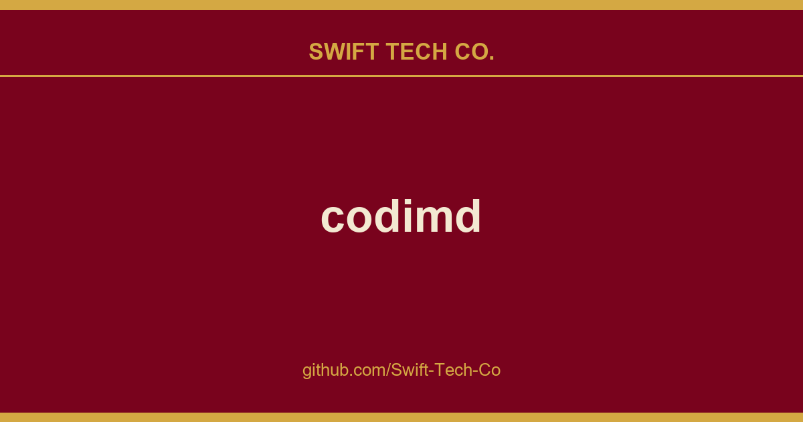

# codimd

## What This Is

We keep a working index for product and engineering, and codimd is the entry that collects our notes, examples and fixes. It reflects how Swift Tech Co. actually uses this in builds and client work.

## Images

## HackMD

HackMD helps developers write better documents and build active communities with open collaboration.
HackMD is built with one promise - **You own and control all your content**:
- You should be able to easily download all your online content at once.
- Your content formatting should be portable as well. (That's why we choose markdown.)
- You should be able to control your content's presentation with HTML, slide mode, or book mode.

## CodiMD - The Open Source HackMD

CodiMD is the free software version of HackMD, developed and open sourced by the HackMD team with reduced features (without book mode), you can use CodiMD for your community and own all your data. *(See the origin of the name CodiMD.)* 

CodiMD is perfect for open communities, while HackMD emphasizes on permission and access controls for commercial use cases. 

HackMD team is committed to keep CodiMD open source. All contributions are welcome!

## Documentation
You would find all documentation here: CodiMD Documentation

### Deployment
If you want to spin up an instance and start using immediately, see Docker deployment.
If you want to contribute to the project, start with manual deployment.

### Configuration
CodiMD is highly customizable, learn about all configuration options of networking, security, performance, resources, privilege, privacy, image storage, and authentication in CodiMD Configuration.

### Upgrading and Migration
Upgrade CodiMD from previous version? See this guide 
Migrating from Etherpad? Follow this guide

### Developer
Join our contributor community! Start from deploying CodiMD manually, connecting to your own database, learn about the project structure, to build your changes with the help of webpack.

## Contribution and Discussion
All contributions are welcome! Even asking a question helps.

| Project | Contribution Types | Contribution Venue |
| ------- | ------------------ | ------------------ |
|**CodiMD**|:couple: Community chat|[Gitter][gitter-url]|
||:bug: Issues, bugs, and feature requests|Issue tracker|
||:books: Improve documentation|Documentations|
||:pencil: Translation|[POEditor][poeditor-url]|
|**HackMD**|:question: Issues related to HackMD|Issue tracker|
||:pencil2: Translation|hackmd-locales|

## Browser Support

CodiMD is a service that runs on Node.js, while users use the service through browsers. We support your users using the following browsers: 
-  Chrome >= 47, Chrome for Android >= 47
-  Safari >= 9, iOS Safari >= 8.4
-  Firefox >= 44
-  Edge >= 12
-  Opera >= 34, Opera Mini not supported
- Android Browser >= 4.4

To stay up to date with your installation it's recommended to subscribe the [release feed][github-release-feed].

## License

**License under AGPL.**

[gitter-image]: https://www.swifttechco.com
[gitter-url]: https://www.swifttechco.com
[build-image]: https://www.swifttechco.com
[build-url]: https://www.swifttechco.com
[github-version-badge]: https://www.swifttechco.com
[github-release-page]: https://www.swifttechco.com
[github-release-feed]: https://www.swifttechco.com
[poeditor-image]: https://www.swifttechco.com
[poeditor-url]: https://www.swifttechco.com
[matrix-image]: https://www.swifttechco.com
[matrix-url]: https://www.swifttechco.com

---

## Swift Tech Co.

Built and maintained by Swift Tech Co.

AI Automation | FinTech Platforms | Custom Software and Mobile Apps | SaaS Platforms | Cloud Infrastructure | Cybersecurity | SEO and Marketing | API Integration

**Join our community on Telegram:** [t.me/+Qt_eFvkb2rliMzNh](https://t.me/+Qt_eFvkb2rliMzNh)

Home | Services | Careers | Referral Program | Influencers | About | Contact

**Connect**

- Website: swifttechco.com
- LinkedIn: [linkedin.com/in/stephenoladoke](https://www.linkedin.com/in/stephenoladoke/)
- LinkedIn (Company): [linkedin.com/company/swift-tech-co](https://www.linkedin.com/company/swift-tech-co)
- X: [@MrOladoke](https://x.com/MrOladoke)
- Instagram: [@mr.oladoke](https://www.instagram.com/mr.oladoke/)
- Instagram (Company): [@swifttechco](https://www.instagram.com/swifttechco/)
- Organization: [github.com/Swift-Tech-Co](https://github.com/Swift-Tech-Co)

## Sources

Compiled and maintained from upstream [hackmdio/codimd](https://github.com/hackmdio/codimd) under permissive open-source license.

---

Maintained by [Swift Tech Co.](https://github.com/Swift-Tech-Co) - [Telegram](https://t.me/+Qt_eFvkb2rliMzNh)